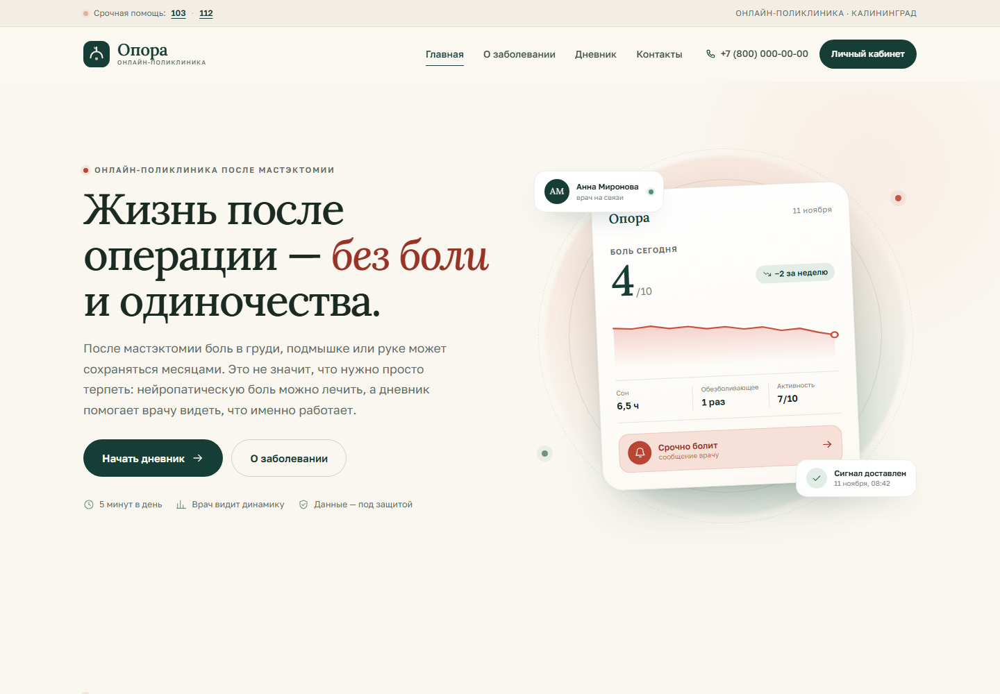
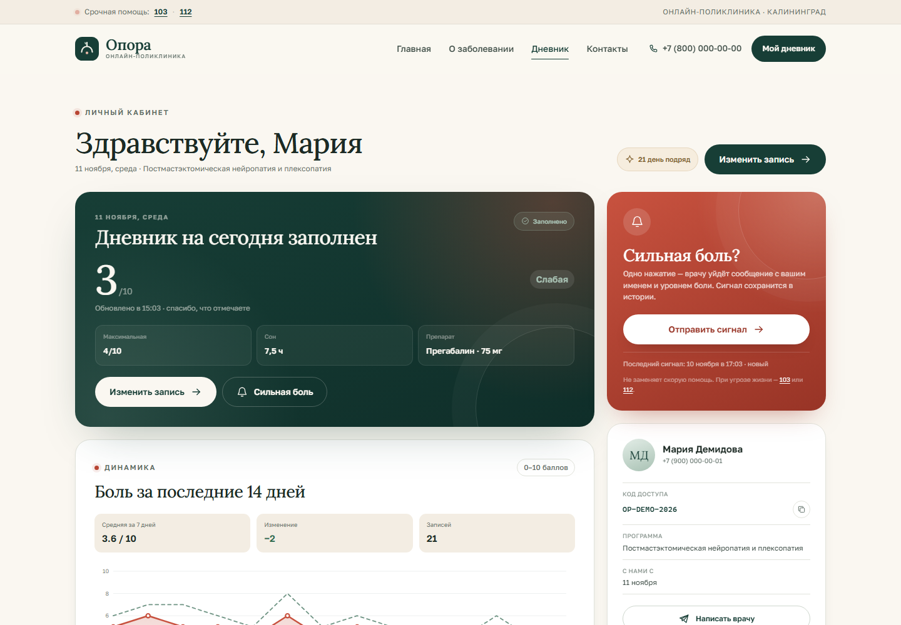
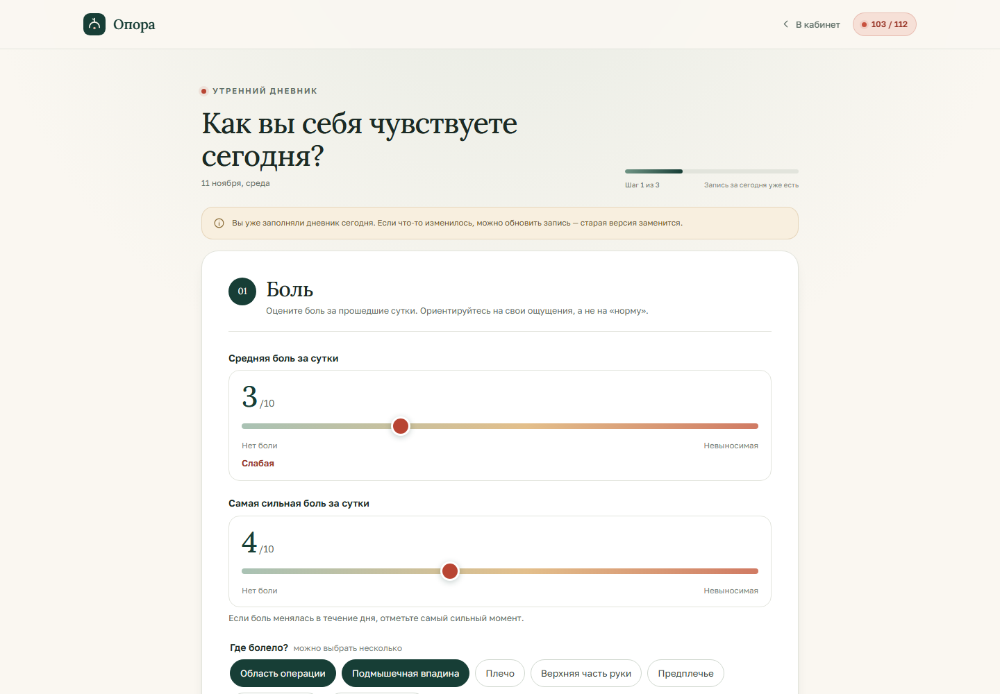
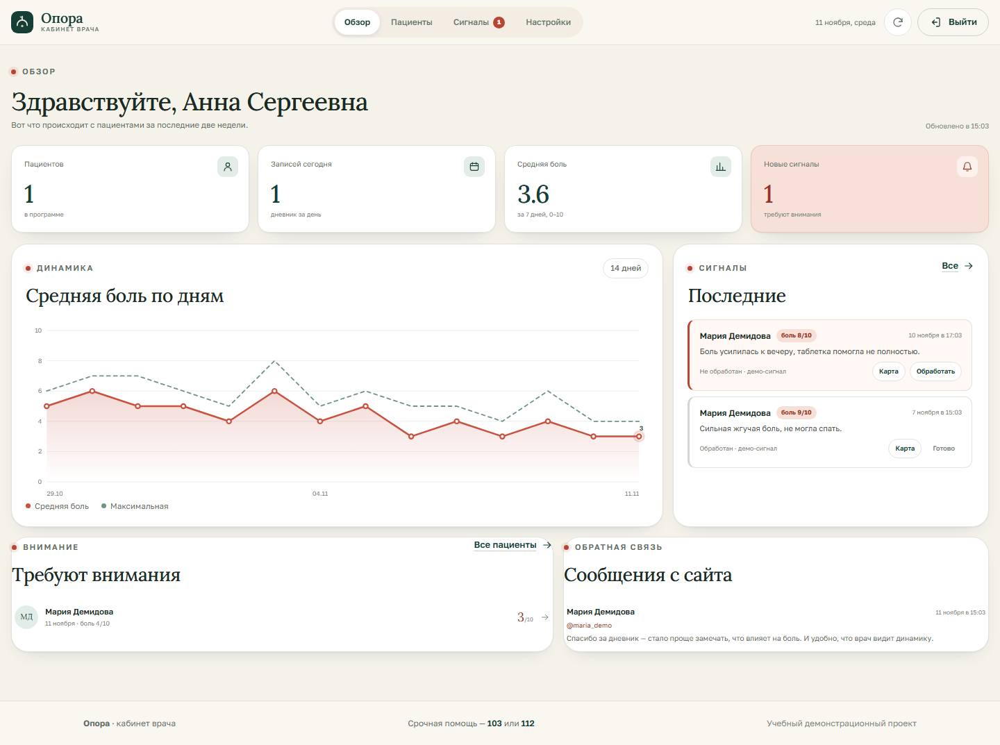

# Опора — онлайн-поликлиника после мастэктомии

Учебный проект по теме **«Пациенты с постмастэктомической нейропатией и плексопатией»**.

Сайт-дневник для пациенток: ежедневная анкета о боли, сон, препараты и их эффективность; графики для врача; тревожная кнопка, которая отправляет уведомление с именем пациентки в Telegram. Плюс понятная памятка о заболевании, режим работы, обратная связь и экстренные номера.

> Это демонстрационный проект, а не медицинская организация. Он не оказывает медицинских услуг, не ставит диагнозы и не заменяет врача. При угрозе жизни — **103** или **112**.



## Что реализовано по ТЗ

| Пункт ТЗ | Где в проекте |
|---|---|
| 1. Создать онлайн-поликлинику в интернете | Публичный сайт с главной, памяткой, личным кабинетом и кабинетом врача |
| 2. Выбрать соцсеть для связи | Telegram: уведомления врачу и контакт для пациентов; для реальной эксплуатации рекомендован MAX/VK или защищённый контур |
| 3. Ежедневный опросник по профилю заболевания | Трёхшаговый дневник: боль по NRS, локализация и характер боли, ночные пробуждения, онемение/слабость/отёк, сон, настроение, активность, препараты, дозы, эффективность, побочные эффекты и приверженность |
| 4. Пациент заполняет утром, врач анализирует эффективность | Личный кабинет с историей и графиками; кабинет врача с динамикой по каждому пациенту, сигналами и выгрузкой CSV |
| 5. Дополнительная информация для пациентов | Страница «О заболевании»: причины, симптомы, варианты течения, диагностика, лечение, реабилитация, красные флаги, FAQ; режим работы, обратная связь, экстренные номера |
| Тревожная кнопка | В кабинете и на странице дневника: имя, уровень боли, комментарий → Telegram врачу + запись в кабинете врача; защита от повторных нажатий |

### Демо-доступ

После `npm run seed`:

- пациентка: код **`OP-DEMO-2026`** (вход на `/login`);
- врач: `/doctor`, пароль **`opora-demo-2026`** (если не задан `DOCTOR_PASSWORD`).

Демо-пациентка — «Мария Демидова», 21 запись дневника и два сигнала. Данные вымышленные.

## Скриншоты

| Личный кабинет | Дневник |
|---|---|
|  |  |

| Кабинет врача | Телефон |
|---|---|
|  |  |

## Быстрый запуск

Нужен **Node.js 20+** (рекомендуется 22) и npm.

```bash
npm ci
cp .env.example .env
# откройте .env и задайте DOCTOR_PASSWORD, SESSION_SECRET, Telegram
npm run seed
npm start
```

Откройте <http://localhost:3000>.

На Windows вместо `cp`:

```powershell
Copy-Item .env.example .env
```

Без Telegram сайт тоже работает: тревожные сигналы сохраняются в кабинете врача, но не дублируются в мессенджер. Для локальной проверки отправки:

```bash
npm run test:telegram
```

### Переменные окружения

| Переменная | Обязательна | Назначение |
|---|---|---|
| `PORT` | нет | Порт приложения, по умолчанию 3000 |
| `NODE_ENV` | нет | `production` включает HSTS и безопасные заголовки |
| `TZ` | нет | Часовой пояс процессов; сайт использует `Europe/Kaliningrad` из `shared/site.js` |
| `DOCTOR_PASSWORD` | да, для публикации | Пароль в кабинет врача |
| `SESSION_SECRET` | да, для публикации | Подпись сессий врача (32+ случайных байта) |
| `TELEGRAM_BOT_TOKEN` | для уведомлений | Токен бота от @BotFather |
| `TELEGRAM_CHAT_ID` | для уведомлений | Числовой chat_id получателя; можно несколько через запятую |
| `TELEGRAM_API_BASE` | нет | Подмена API для тестов |
| `ALARM_COOLDOWN_SEC` | нет | Антиспам тревожной кнопки, по умолчанию 120 секунд |
| `DATABASE_URL` | нет | PostgreSQL (Neon/Supabase/РФ). Без неё используется PGlite в `./data` |
| `DATABASE_SSL` | нет | `disable`, если PostgreSQL без SSL |
| `PGLITE_DIR` | нет | Каталог PGlite, по умолчанию `./data/pglite` |

## Telegram за 5 минут

1. В Telegram откройте **@BotFather** → `/newbot` → имя и username бота → получите токен.
2. Получатель (**@Sson1ta**) должен открыть бота и нажать **/Start**. Бот не может написать первым.
3. Узнайте числовой `chat_id`: напишите **@userinfobot** или откройте
   `https://api.telegram.org/bot<ТОКЕН>/getUpdates` после сообщения боту и найдите `"chat":{"id":...}`.
4. Вставьте `TELEGRAM_BOT_TOKEN` и `TELEGRAM_CHAT_ID` в `.env` (локально) или в Render.
5. Откройте `/doctor` → «Настройки» → «Отправить тестовое сообщение».

Подробная инструкция и разбор ошибок — в [DEPLOY.md](DEPLOY.md).

## Деплой

Самый быстрый бесплатный вариант для домашки — **Render** (Node) + при желании **Neon** (PostgreSQL). Пошагово, с учётом законодательства РФ: **[DEPLOY.md](DEPLOY.md)**.

Коротко:

1. Залейте проект в приватный GitHub-репозиторий.
2. Render → New → Blueprint (файл `render.yaml`) или New Web Service.
3. Задайте `DOCTOR_PASSWORD`, `TELEGRAM_BOT_TOKEN`, `TELEGRAM_CHAT_ID`; `SESSION_SECRET` можно сгенерировать.
4. Для сохранения данных добавьте `DATABASE_URL` от Neon и перезапустите сервис.
5. Откройте `/doctor`, проверьте Telegram и загрузите демо-данные.

Бесплатный инстанс Render засыпает через 15 минут; первый запрос после сна может занять 30–60 секунд. Без `DATABASE_URL` данные на бесплатном хостинге могут сброситься при перезапуске — это ограничение демо-контура.

## Структура проекта

```
server/
  index.js       запуск, graceful shutdown
  app.js         Express, маршруты страниц и API, безопасность
  db.js          PGlite/PostgreSQL, схема
  repo.js        запросы, демо-данные, CSV
  auth.js        коды пациентов, токены, сессия врача
  validate.js    серверная валидация
  notify.js      Telegram API и шаблоны сообщений
  time.js        даты и часовой пояс клиники
views/
  partials/      шапка, подвал, иконки
  pages/         главная, памятка, вход, кабинет, дневник, врач, правовые страницы
public/
  css/           дизайн-система и адаптивность
  js/            клиентская логика (без сборщика)
  fonts/         Golos Text + Lora, self-hosted
shared/
  site.js        публичные настройки клиники и врача
  options.js     справочники дневника (используются сервером и браузером)
tests/
  api.test.js    интеграционные тесты API
scripts/
  screenshot.mjs     скриншоты через headless Edge (опционально)
  functional-test.mjs сквозной браузерный сценарий (опционально)
docs/screenshots/
render.yaml      Blueprint для Render
Dockerfile       для VPS/Fly.io/РФ-хостинга
DEPLOY.md        деплой и правовой разбор
```

## API (кратко)

| Метод | Путь | Назначение |
|---|---|---|
| `POST` | `/api/patients` | регистрация пациентки |
| `POST` | `/api/patients/login` | вход по коду, ротация токена |
| `GET` | `/api/patient/me` | кабинет: профиль, сегодняшняя запись, история, статистика |
| `POST` | `/api/patient/surveys` | сохранить/обновить дневник за сегодня |
| `POST` | `/api/patient/alerts` | тревожный сигнал + Telegram |
| `POST` | `/api/feedback` | обратная связь с сайта |
| `POST` | `/api/doctor/login` | вход врача |
| `GET` | `/api/doctor/overview` | сводка, пациенты, график, сигналы, сообщения |
| `GET` | `/api/doctor/patients/:id` | карта пациента |
| `DELETE` | `/api/doctor/patients/:id` | удаление пациента и его данных |
| `GET` | `/api/doctor/export.csv` | выгрузка дневников |
| `POST` | `/api/doctor/test-telegram` | тест уведомлений |
| `POST` | `/api/doctor/demo-seed` | демо-пациентка и история |
| `GET` | `/api/health` | health-check для Render |

Авторизация — `Authorization: Bearer <token>`. Токены пациентов хранятся в виде SHA-256 хешей, сессия врача подписана HMAC и живёт 12 часов.

## Безопасность и приватность

- HTTPS, CSP, HSTS в production, `X-Frame-Options: DENY`, ограничение частоты запросов.
- Пароль врача не хранится в коде/БД, только в переменной окружения.
- Пароли/токены не пишутся в логи; тела запросов не логируются.
- Валидация всех полей на сервере, параметризованные SQL-запросы.
- В дневнике только необходимые данные; телефон — необязателен.
- Токен пациентки — в `localStorage`; сессия врача — в `sessionStorage`.
- Демо-режим закрыт от индексации (`noindex`), в подвале и правовых страницах есть дисклеймер.
- Врач может удалить пациента и все его записи; пациент может запросить удаление через контакты.

**Важно:** это демо. Для реальных персональных данных и медицинской тайны нужен отдельный контур в РФ, согласия, уведомление Роскомнадзора и защищённая МИС. См. [DEPLOY.md](DEPLOY.md#9-законодательство-рф-что-нужно-знать-перед-реальным-запуском).

## Тесты

```bash
npm test
```

Проверяются регистрация, валидация, дневник, кулдаун тревожного сигнала, вход врача, карта пациента, CSV, обратная связь, демо-данные и удаление.

Опционально, если установлен Microsoft Edge:

```bash
npm run test:ui
```

Скрипт делает скриншоты и проходит сценарий «регистрация → дневник → тревожная кнопка → врач → удаление». В средах с жёсткой песочницей браузеру может понадобиться полный доступ.

## Что заменить перед показом / реальным запуском

1. **`shared/site.js`** — название клиники, имя и специализация врача, телефон, e-mail, Telegram, город, часы работы, `demo`.
2. **`views/pages/privacy.ejs`, `consent.ejs`, `terms.ejs`** — реквизиты оператора, лицензия, реальные контакты, сроки хранения.
3. **`.env`** — `DOCTOR_PASSWORD`, `SESSION_SECRET`, Telegram.
4. **`views/pages/index.ejs`** — если нужно, фото/имя врача и тексты.
5. **`site.demo`** — поставить `false` только после юридической подготовки; это лишь убирает демо-пометки, но не делает проект соответствующим 152-ФЗ автоматически.
6. **Демо-данные** — не хранить в боевой базе; кнопка «Загрузить демо-данные» предназначена для показа.

## Правовой статус

Проект учебный. Он **не является** медицинской организацией, медицинским изделием или телемедицинской платформой. Информация на сайте носит справочный характер и не заменяет консультацию врача. Медицинские данные реальных пациентов нельзя размещать в демо-контуре на зарубежном хостинге и передавать в личный Telegram врача без выполнения требований 152-ФЗ, 323-ФЗ и подзаконных актов.

Подробный чек-лист для реального запуска (хостинг в РФ, Роскомнадзор, согласия, врачебная тайна, телемедицина, реклама) — в [DEPLOY.md](DEPLOY.md#9-законодательство-рф-что-нужно-знать-перед-реальным-запуском).

---

Сделано для учебного задания. Если что-то в тексте или логике нужно поправить под требования преподавателя — начните с `shared/site.js` и страниц в `views/pages`.
